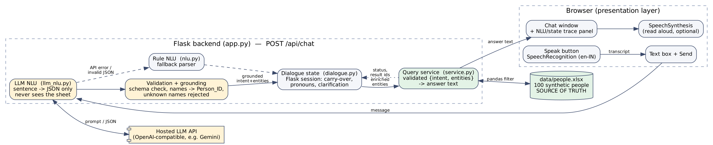

# Architecture (final system, V5)



## Layers

| Layer | File(s) | Responsibility | Never does |
|---|---|---|---|
| Presentation | `templates/index.html`, `static/chat.js` | Text box, Speak button (SpeechRecognition), chat window, read-aloud (SpeechSynthesis), debug panel | Interpret language or look up facts |
| NLU (LLM) | `llm_nlu.py` | Sentence to `{intent, entities}` JSON | Answer questions; see the spreadsheet |
| Validation / grounding | `llm_nlu.py: validate_and_ground` | Schema + range checks; names to `Person_ID`; unknown person/relationship/place flagged | Trust the model |
| NLU (rules) | `nlu.py` | Deterministic fallback parser (also the V2/V3 parser) | |
| Dialogue | `dialogue.py` | Context carry-over, pronouns, clarification answers (Flask session) | Execute queries |
| Query service | `service.py` | Filter pandas data, validate dates, format reply | Parse language |
| Data | `data_service.py`, `data/people.xlsx` | Load, validate, clean the 100 records | |

## One request, end to end

1. Browser sends `{message}` to `POST /api/chat` (typed, or the speech transcript).
2. `parse_message`: LLM parse then validation/grounding; on API error or invalid output, rule parser (`nlu_source` = `llm`, `rules` or `rules-fallback`).
3. `resolve_clarification` / `enrich_with_context` fill omitted entities from the session state.
4. `execute` queries the DataFrame and returns `{answer, status, result_ids}`.
5. `update_state` stores filters, the last single person, or the pending "which one?" candidates.
6. Browser shows the text (always) and optionally speaks it.

## Evolution

```
V1 Browser -> Flask -> Rule parser -> pandas -> Excel
V2 Browser -> Flask -> Intent+Entity parser -> Query service -> Excel
V3 Browser -> Flask -> NLU -> Dialogue state -> Query service -> Excel
V4 Browser -> Flask -> LLM NLU -> Grounding/Validation (-> rule fallback) -> Dialogue -> Query service -> Excel
V5 Speech -> Browser -> same V4 backend -> Browser speech synthesis
```

## Key design decisions

- **Grounding boundary:** the only data crossing to the LLM is the user's sentence and a fixed prompt. Every returned value is validated, so a hallucinated person ("Rahul Patel") becomes "I could not find...", never a guessed record.
- **Fallback:** the system degrades to the rule parser rather than failing when the API is down or rate-limited.
- **Clarify, don't guess:** singular relationship questions and shared first names produce "Which one do you mean?"; the answer is matched against the pending candidates (so "Nikhil" correctly asks again between Nikhil Hegde and Nikhil Bhat).
- **Context is conservative:** follow-up filters carry only when the turn names no person and does not restate the task (no word "birthday"); a new month replaces the old one; Reset clears everything.
- **Voice is a channel:** V5 changes only the browser; text is always displayed.
